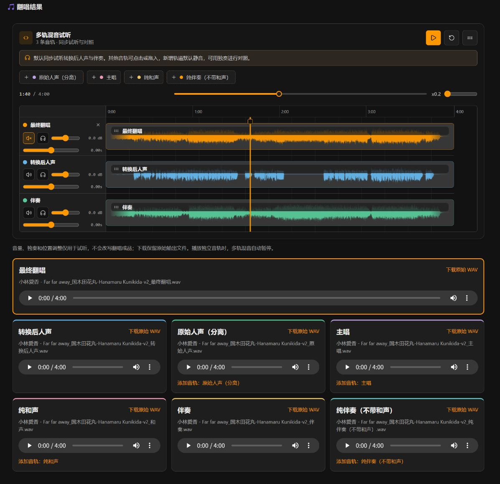
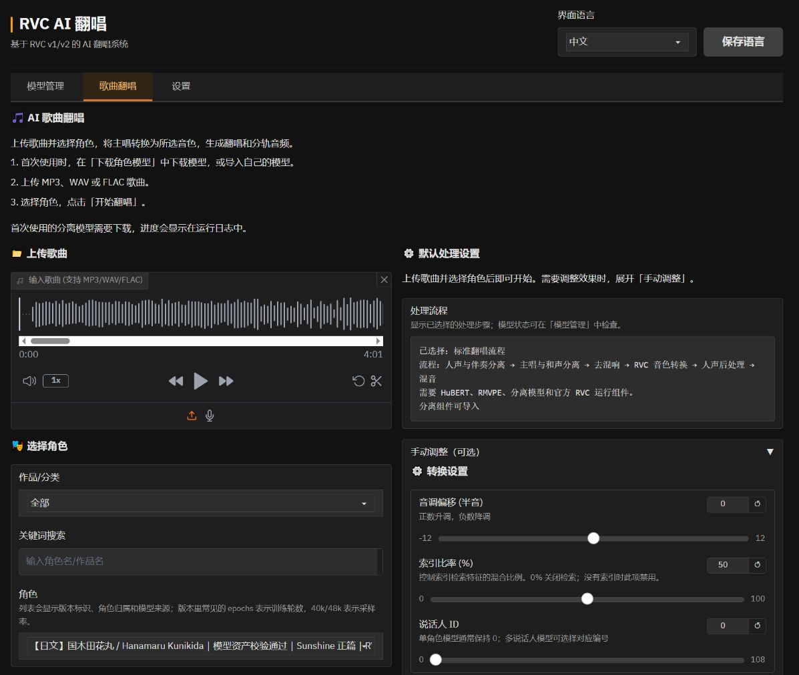
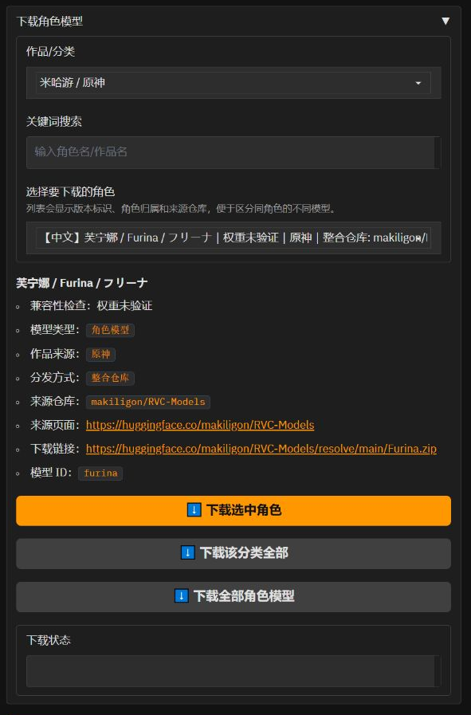
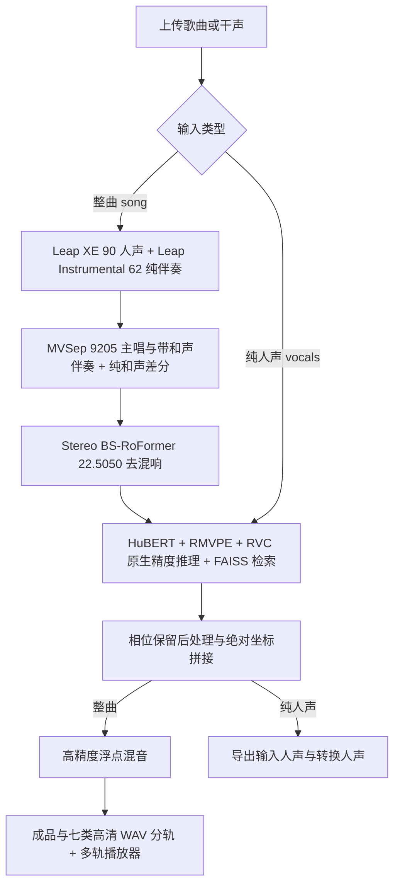

# AI-RVC 一键 AI 翻唱 / RVC Voice Conversion WebUI

AI-RVC 是一个开源的 [RVC v1/v2](https://github.com/RVC-Project/Retrieval-based-Voice-Conversion-WebUI) 一键翻唱工作台，完整集成人声/伴奏分离、主唱/和声分离、去混响、RMVPE 音高提取、RVC 音色转换、FAISS 精确检索、同步多轨混音试听与全套分轨高清 WAV 导出，可直接处理 MP3、WAV 和 FLAC 音频。

> **English Overview:** AI-RVC is a standalone open-source [RVC v1/v2](https://github.com/RVC-Project/Retrieval-based-Voice-Conversion-WebUI) song cover studio with vocal/instrumental separation, lead/backing separation, dereverb, RMVPE pitch extraction, FAISS retrieval, synchronized multitrack preview, batch covers, and full Light/Dark bilingual WebUI.
>
> 在线体验：[TelkNet AI 翻唱](https://telknet.cc/tools/ai-rvc) · 发行下载：[GitHub Releases](https://github.com/mason369/AI-RVC/releases/latest) · 完整更新：[CHANGELOG](CHANGELOG.md)

## 核心特性

- **现代工作室界面**：支持 **日间 / 夜间双主题** 即时切换（自动跟随系统偏好并本地记忆）与 **中 / 英文界面** 无刷新切换，桌面与移动端响应式自适应，所有前端资源完全离线内置。
- **整曲翻唱与纯人声转换**：支持完整歌曲一键翻唱，也支持直接输入干声执行纯人声音色转换（输出输入人声与转换人声两轨）。
- **高质量默认分离链**：输入统一解码为 44.1 kHz 双声道 Float32 WAV；使用 Leap XE 90 提取人声、Leap Instrumental 62 提取纯伴奏、MVSep 9205 三模型 `avg_wave` 分离主唱与带和声伴奏，并差分推导纯和声；默认内置 Stereo BS-RoFormer 22.5050 去混响。
- **同步多轨混音试听**：离线内嵌多轨时间轴播放器，支持同步播放、逐轨增益、静音、独奏、时间偏移、波形缩放、拖入对照轨及七类原始高清 WAV 独立下载。
- **同曲调参自动复用**：同一页面调整音高或更换角色时自动复用已有分轨；仅调音量、混响或原唱混入比例时直接复用转换人声重新混音。
- **批量队列翻唱**：一次上传多首歌曲或多段干声，按顺序批量处理并逐首显示状态，支持切换试听单首分轨或打包下载整批成品 ZIP。
- **RVC v1 / v2 全兼容**：支持原生 256 / 768 维 `.pth` 权重、带 F0 / 无 F0 模型、32 / 40 / 48 kHz 采样率、多说话人 ID、Applio HiFi-GAN / MRF / RefineGAN 架构，以及完整 FP32 向量精确 FAISS 检索与标准双索引角色包。
- **内置角色库与自定义导入**：内置 181 个角色模型条目（支持分类筛选、关键词搜索与在线下载），并支持上传自定义 `.pth`、`.index` 或 `.zip` 模型包。
- **多平台与容器支持**：提供 Windows / Linux 的 CPU 与 NVIDIA CUDA 便携包、Docker Compose 镜像、Google Colab 笔记本、Hugging Face Spaces 入口及本地安装脚本。

## 界面预览



<details>
<summary>查看更多界面截图（翻唱工作台与角色下载）</summary>





</details>

## 默认模型链路

| 处理环节 | 默认模型 | 输入 → 输出 | 参考来源 |
|---|---|---|---|
| 人声分离 | [BS-RoFormer Leap XE 90 bands](https://huggingface.co/pcunwa/BS-Roformer-Leap) | 44.1 kHz Float32 整曲 → `vocals.wav` | [MVSep 10178](https://mvsep.com/quality_checker/entry/10178) |
| 纯伴奏分离 | [BS-RoFormer Leap Instrumental 62 bands](https://huggingface.co/pcunwa/BS-Roformer-Leap) | 44.1 kHz Float32 整曲 → `accompaniment_without_harmony.wav` | [伴奏实测](docs/伴奏模型实测.md) |
| 主唱与带和声伴奏 | `BS-Kar-Gabox_IS + BS-Kar-Frazer&Becruily + BS-Kar-Anvuew (AVG)` | 原始整曲 → `lead_vocals.wav` + `accompaniment.wav` | [MVSep 9205](https://www.mvsep.com/quality_checker/entry/9205) |
| 纯和声推导 | Leap 人声 − MVSep 主唱 | `vocals.wav - lead_vocals.wav` → `backing_vocals.wav` | 差分导出 |
| 去混响 | [Stereo BS-RoFormer De-Reverb 22.5050](https://huggingface.co/anvuew/dereverb_bs_roformer) | 主唱 → 干净干声 | `dereverb_bs_roformer_anvuew_sdr_22.5050.ckpt` |
| 内容特征 | [HuBERT Base](https://arxiv.org/abs/2106.07447) | 人声 → 语音内容特征 | Transformers 目录 / fairseq `.pt` |
| 音高提取 | [RMVPE](https://arxiv.org/abs/2306.15412) | 人声 → F0 基频曲线 | `rmvpe.pt` |
| 音色转换 | [RVC v1/v2](https://github.com/RVC-Project/Retrieval-based-Voice-Conversion-WebUI) + [FAISS](https://github.com/facebookresearch/faiss) | 主唱 + `.pth` / `.index` → `converted_vocals.wav` | 原生精度推理与精确检索 |

> 详细伴奏模型对比实测见 [docs/伴奏模型实测.md](docs/伴奏模型实测.md)，完整架构与精度说明见 [docs/有效性与模型兼容性.md](docs/有效性与模型兼容性.md)。

## 快速开始

| 运行方式 | 环境要求 | 硬件加速 | 适用场景 |
|---|---|---|---|
| **便携可执行包** | 无需 Python，解压即用 | 可选 CPU 版或 NVIDIA CUDA 版 | 桌面快速上手（推荐） |
| **Docker Compose** | Docker + Compose（GPU 需 NVIDIA Container Toolkit） | CPU / NVIDIA CUDA 镜像 | Linux / WSL2 服务器部署 |
| **本地一键安装** | Python 3.10 | CUDA / ROCm / XPU / DirectML / MPS / CPU | 开发与自定义后端 |
| **Google Colab** | 浏览器 + Google 账号 | Colab GPU | 云端批量翻唱 |
| **Hugging Face Spaces** | 浏览器 | 取决于 Space 硬件配置 | 在线体验 |

### 推荐硬件配置

| 使用场景 | GPU | 内存 | 存储 | 说明 |
|---|---|---|---|---|
| 常规整曲翻唱（默认六模型） | NVIDIA CUDA 16 GB 显存 | 32–64 GB | NVMe SSD，15 GB+ 可用空间 | 适合 3–5 分钟完整歌曲，和声分离保持开启 |
| 长歌曲或批量任务 | NVIDIA CUDA 24 GB+ 显存 | 64 GB | NVMe SSD，30 GB+ 可用空间 | 适合连续批量队列处理 |
| 8–12 GB 显存显卡 | NVIDIA CUDA | 32 GB | SSD，15 GB+ 可用空间 | 如遇显存紧张，可在手动调整中关闭和声分离 |
| CPU 模式 | 无需显卡 | 32 GB | SSD，15 GB+ 可用空间 | 功能完整可用，整曲推理耗时较长 |

---

### 方式 1：便携可执行包（无需 Python）

1. 从 [GitHub Releases](https://github.com/mason369/AI-RVC/releases/latest) 下载所需版本的全部分卷及对应 `SHA256SUMS` 校验文件：
   - **Windows**：`AI-RVC-Windows-CPU-Portable.7z.*` 或 `AI-RVC-Windows-GPU-Portable.7z.*`
   - **Linux**：`AI-RVC-Linux-CPU-Portable.tar.gz.part*` 或 `AI-RVC-Linux-GPU-Portable.tar.gz.part*`
2. 放在同一目录下解压：
   - **Windows**：使用 7-Zip 打开 `.7z.001` 解压到新目录，双击 `AI-RVC-Windows-CPU.exe` 或 `AI-RVC-Windows-GPU.exe`。
   - **Linux**：合并解压并赋予执行权限：
     ```bash
     cat AI-RVC-Linux-GPU-Portable.tar.gz.part* | tar -xzf -
     chmod +x AI-RVC-Linux-GPU-Portable/AI-RVC-Linux-GPU
     ./AI-RVC-Linux-GPU-Portable/AI-RVC-Linux-GPU
     ```
3. 浏览器打开 `http://127.0.0.1:7860` 即可使用。

> 便携包已内置基础模型、默认分离模型、FFmpeg 与离线多轨播放器；角色模型在界面按需下载或导入。GPU 便携包针对 NVIDIA CUDA 运行栈，ROCm / XPU / DirectML / MPS 请使用本地安装方式。

---

### 方式 2：Docker Compose

```bash
# NVIDIA CUDA（推荐）
docker compose pull
docker compose run --rm ai-rvc prepare
docker compose up -d

# CPU 版本
docker compose -f compose.cpu.yaml pull
docker compose -f compose.cpu.yaml run --rm ai-rvc prepare
docker compose -f compose.cpu.yaml up -d
```

启动后访问 `http://127.0.0.1:7860`。配置、模型与作品保存在 `/data` 持久化卷中。登录保护、反向代理、备份恢复与离线迁移说明见 [docs/Docker使用指南.md](docs/Docker使用指南.md)。

---

### 方式 3：本地一键安装

**Windows**

```powershell
git clone https://github.com/mason369/AI-RVC.git
cd AI-RVC
python install.py
```

**Linux / WSL2**

```bash
git clone https://github.com/mason369/AI-RVC.git
cd AI-RVC
sudo apt-get update
sudo apt-get install -y build-essential libsndfile1 libsamplerate0 ffmpeg portaudio19-dev
python3.10 install.py
```

**macOS (Apple Silicon，实验性)**

```bash
brew install libsamplerate ffmpeg
export DYLD_LIBRARY_PATH="$(brew --prefix libsamplerate)/lib${DYLD_LIBRARY_PATH:+:$DYLD_LIBRARY_PATH}"
python3.10 install.py --backend mps
```

常用安装选项：
- `--check`：仅检查环境与依赖状态
- `--cpu`：安装 CPU 版本
- `--backend auto|cpu|cuda|rocm|xpu|directml|mps`：指定计算后端（ROCm / XPU / DirectML 需先按官方指南安装对应 PyTorch 运行栈）
- `--no-run`：仅安装依赖，不自动启动界面

安装完成后日常启动：
- Windows：`.\venv310\Scripts\python.exe .\run.py --host 127.0.0.1 --port 7860`
- Linux / WSL2 / macOS：`./venv310/bin/python ./run.py --host 127.0.0.1 --port 7860`

> Windows 与 WSL2 共用同一代码目录时，可在 WSL 中设置 `export AI_RVC_VENV_DIR="$HOME/.venvs/ai-rvc"` 将 Linux 虚拟环境放在 WSL 目录中，并通过 `AI_RVC_DEVICE` 指定各自后端。

<details>
<summary>手动安装步骤（高级用户）</summary>

```bash
python3.10 -m venv venv310
# 激活虚拟环境后：
python -m pip install -r pre-requirements.txt
# 从 https://pytorch.org/get-started/locally/ 安装与本机显卡匹配的 PyTorch 三件套
pip install -r requirements_cuda.txt   # 或 requirements_cpu.txt / requirements_dml.txt
python tools/download_models.py
python run.py
```

</details>

---

### 方式 4：Google Colab 与 Hugging Face Spaces

- **Google Colab**：打开 [AI_RVC_Colab.ipynb](https://colab.research.google.com/github/mason369/AI-RVC/blob/master/AI_RVC_Colab.ipynb)，将运行时设为 GPU 后依次运行第 1–5 步准备环境，在第 7 步上传歌曲或干声即可批量翻唱并下载成品 ZIP。
- **Hugging Face Spaces**：访问 [mason369/AI-RVC](https://huggingface.co/spaces/mason369/AI-RVC)，部署配置见 [README_HF.md](README_HF.md)。

## 使用指南

### 歌曲翻唱与纯人声转换

1. 打开界面后默认进入 **「歌曲翻唱」** 工作台（可在顶栏即时切换 **日间 / 夜间模式** 与 **中文 / English**）。
2. **获取声线**：首次使用可在左侧展开 **「下载角色模型」** 搜索下载内置声线，或展开 **「上传自定义模型」** 导入本地 `.pth` / `.index` / `.zip`。
3. **上传音频**：选择 **「整曲翻唱」** 或 **「纯人声转换」**，上传 MP3、WAV 或 FLAC 音频。
4. **开始翻唱**：选中已下载角色，点击 **「开始翻唱」**。如需精调音调、索引比率、说话人 ID、和声保留或混音比例，可展开右侧 **「手动调整（可选）」**。
5. **试听与导出**：完成后在下方 **多轨混音试听** 面板同步播放、逐轨独奏对比并下载原始高清 WAV（包含最终翻唱、转换后人声、原始人声、主唱、纯和声、带和声伴奏、纯伴奏）。

### 同曲复用与批量翻唱

- **同曲微调复用**：在同一浏览器会话中调整升降调或更换角色后重新生成，会自动复用已分离的人声与伴奏；仅调整音量、混响、原唱混入或和声开关时，直接复用已转换人声快速重混。
- **批量翻唱**：选定声线与参数后展开 **「批量翻唱」**，一次添加多首文件并点击 **「开始批量处理」**。完成后可切换任意曲目在多轨播放器中试听，或点击 **「下载本批成品 (ZIP)」** 一键打包导出。

## 参数与配置说明

### 核心参数

| 参数 | 说明 | 默认值 |
|---|---|---|
| 音调偏移 | 半音移调（正数升调，负数降调，Web 范围 `-12` 至 `+12`） | `0` |
| F0 提取方法 | 音高算法（官方入口支持 `rmvpe` / `pm` / `fcpe`） | `rmvpe` |
| 索引比率 | FAISS 检索特征混合比例（0% 关闭） | `50%` (`0.5`) |
| 清辅音保护 | 保护辅音与气声（范围 `0–0.5`，`0.5` 关闭） | `0.33` |
| 响度包络贴合 | 控制人声音量起伏贴合原曲的程度 | `0%` (`0.0`) |
| 混音预设 | 通用（100/100/0）、人声突出（115/90/0）、伴奏突出（90/115/0）、现场感（100/100/10） | 通用 |
| 原主唱混入 | 混入原唱主唱以增加自然度 | `0%` |
| 原曲结构贴合 | 控制转换人声对原曲发声时机与结构的贴合（自动 / 关闭 / 始终开启） | 自动 |
| 转换方式 | 标准翻唱（推荐，含和声分离与后处理）/ 官方 RVC 路线（经典 UVR5 流程） | 标准翻唱 |

### 配置文件（`configs/config.json`）

```json
{
  "language": "zh_CN",
  "device": "cuda",
  "weights_dir": "assets/weights",
  "output_dir": "outputs",
  "cover": {
    "input_mode": "song",
    "separator": "roformer",
    "roformer_model": "hybrid:leap_xe90_vocals+leap62_instrumental",
    "karaoke_separation": true,
    "karaoke_model": "ensemble:mvsep_9205_avg",
    "karaoke_merge_backing_into_accompaniment": true,
    "uvr5_model": "HP2_all_vocals",
    "uvr5_agg": 10,
    "uvr5_format": "wav",
    "use_official": true,
    "demucs_model": "htdemucs_ft",
    "demucs_shifts": 10,
    "demucs_overlap": 0.5,
    "demucs_split": true,
    "f0_method": "rmvpe",
    "index_rate": 0.5,
    "rms_mix_rate": 0,
    "protect": 0.33,
    "speaker_id": 0,
    "silence_gate": false,
    "silence_threshold_db": -50,
    "silence_smoothing_ms": 50,
    "silence_min_duration_ms": 200,
    "default_vocals_volume": 100,
    "default_accompaniment_volume": 100,
    "default_reverb": 0,
    "backing_mix": 0,
    "source_constraint_mode": "auto",
    "vc_pipeline_mode": "current"
  }
}
```

> DirectML 后端受上游 `audio-separator==0.47.0` 分配器限制，无法运行默认 RoFormer 模型链，请使用 CUDA 或 CPU 后端。

## 处理流程架构



## 本地构建与测试

```bash
# 运行完整单元测试
python -m unittest discover -s tests

# 构建离线内联多轨播放器
cd ui/multitrack && npm ci && npm run build && cd ../..

# 本地构建便携可执行包（需 ffprobe 在 PATH 中）
python tools/download_models.py --all
python tools/package_runtime.py .
python -m PyInstaller AI-RVC.spec
```

更多测试、发布与平台适配说明见：
- [docs/Docker使用指南.md](docs/Docker使用指南.md)
- [docs/有效性与模型兼容性.md](docs/有效性与模型兼容性.md)
- [docs/伴奏模型实测.md](docs/伴奏模型实测.md)
- [docs/平台适配与验收.md](docs/平台适配与验收.md)
- [docs/发布准备.md](docs/发布准备.md)
- [docs/TelkNet同源更新.md](docs/TelkNet同源更新.md)

## 项目结构

```text
AI-RVC/
├── assets/                  # 基础模型、默认分离模型与角色权重
├── configs/                 # 主配置、参数校验与预设配置
├── docker/                  # 容器入口、健康检查与环境样例
├── docs/                    # 技术文档、实测报告与界面截图
├── i18n/                    # 中英文界面语言包与控制台词典
├── infer/                   # 分离、音高提取、RVC 推理与翻唱流水线
├── lib/                     # 音频 I/O、混音、设备管理与日志模块
├── models/                  # 网络结构定义
├── rvc_mcp/                 # MCP 本地音色转换服务
├── tests/                   # 单元测试与合同回归套件
├── tools/                   # 模型下载、角色管理、打包与校验脚本
├── ui/                      # Gradio WebUI 与离线多轨播放器源码
├── run.py                   # 本地与便携版主入口
└── app.py                   # Hugging Face Spaces 入口
```

## 常见问题

**Q: 出现 `CUDA out of memory` 怎么办？**
关闭其他占用显存的程序后重试，或在「手动调整」中关闭「和声分离」以减少显存峰值。

**Q: 高音断音或声音失真怎么调整？**
可先在多轨播放器中对比「主唱」与「转换后人声」定位原因：若转换后出现断音或失真，建议调整「音调偏移」以贴合目标角色音域，适当降低「索引比率」，或选用更清晰的无损音源。

**Q: 角色模型下载失败怎么排查？**
查看运行日志中的具体网络或来源报错；部分第三方外链失效时，可从对应模型仓库手动下载后通过「上传自定义模型」导入。

**Q: 如何确认 CUDA 是否正常启用？**
```bash
nvidia-smi
python -c "import torch; print(torch.__version__, torch.cuda.is_available())"
```

## 许可证与致谢

本项目代码遵循 [MIT License](LICENSE)。第三方模型权重、角色声线与输入音频请遵守各自授权许可并合法合规使用。

致谢开源社区：[RVC-Project](https://github.com/RVC-Project/Retrieval-based-Voice-Conversion-WebUI)、[pcunwa/BS-Roformer-Leap](https://huggingface.co/pcunwa/BS-Roformer-Leap)、[MVSep](https://www.mvsep.com/)、[audio-separator](https://github.com/nomadkaraoke/python-audio-separator)、[RMVPE](https://arxiv.org/abs/2306.15412)、[HuBERT](https://github.com/facebookresearch/fairseq/tree/main/examples/hubert)、[Demucs](https://github.com/facebookresearch/demucs)、[UVR5](https://github.com/Anjok07/ultimatevocalremovergui)、[Gradio](https://gradio.app/)。
