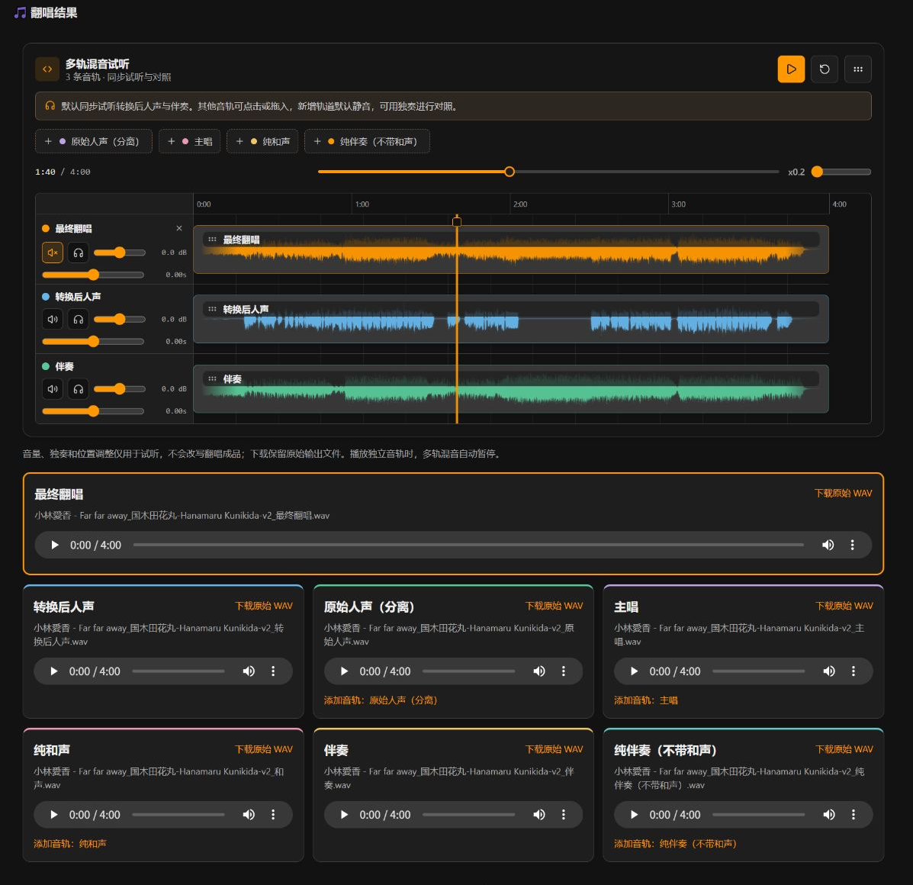

# AI-RVC 一键 AI 翻唱

AI-RVC 是一个基于 [RVC v1/v2](https://github.com/RVC-Project/Retrieval-based-Voice-Conversion-WebUI) 的一键 AI 翻唱与人声音色转换工作台。上传歌曲后可自动完成人声与伴奏分离、主唱与和声分离、去混响、RVC 音色转换与高清浮点混音，支持整曲翻唱、纯人声转换、批量处理与同步多轨试听。

> **English Summary:** AI-RVC is a one-click [RVC v1/v2](https://github.com/RVC-Project/Retrieval-based-Voice-Conversion-WebUI) song cover studio powered by BS-RoFormer Leap XE 90 / Leap Instrumental 62, MVSep 9205 karaoke ensemble, Stereo BS-RoFormer De-Reverb, HuBERT, RMVPE, and FAISS retrieval, complete with synchronized multitrack playback and Light/Dark bilingual UI.

## 界面预览

更多界面截图：[翻唱工作台](docs/Windows界面.png) · [角色模型下载](docs/角色下载.png)

## 核心功能

- **日夜间双主题与中英双语**：支持页首一键切换日间 / 夜间外观以及中文 / English，界面与内置多轨播放器实时同步。
- **同步多轨试听**：支持同步播放、逐轨静音/独奏、增益、时间偏移、波形缩放与拖入对照轨，并支持七类原始浮点 WAV 独立下载。
- **高质量分离链**：输入统一解码为 44.1 kHz 双声道 Float32 WAV；Leap XE 90 提取人声、Leap Instrumental 62 提取纯伴奏、MVSep 9205 三模型 `avg_wave` 提取主唱与带和声伴奏，并差分导出纯和声，搭配 Stereo BS-RoFormer 22.5050 去混响。
- **整曲与纯人声双模式**：支持整曲一键翻唱，也支持直接上传干声执行纯人声换声。
- **同曲复用与批量处理**：同页面调参自动复用已有分轨或转换人声；批量队列支持多文件顺序处理、逐首试听与 ZIP 打包下载。
- **丰富声线库**：内置 181 个角色模型条目，支持分类筛选、关键词搜索、一键下载及自定义 `.pth` / `.index` / `.zip` 导入。

## 默认导出分轨

| 文件 | 内容 | 用途 |
|---|---|---|
| `cover.wav` | 最终翻唱成品 | 完整混音成品 |
| `converted_vocals.wav` | RVC 转换后主唱 | 后期精修或二创 |
| `vocals.wav` | 原始分离人声 | 原唱对照 |
| `lead_vocals.wav` | MVSep 9205 主唱 | 音色转换源轨道 |
| `backing_vocals.wav` | 纯和声轨 | 单独试听或后期混音 |
| `accompaniment.wav` | 带和声伴奏 | 默认成品混音伴奏 |
| `accompaniment_without_harmony.wav` | Leap Instrumental 纯伴奏 | 纯伴奏版本 |

## 使用步骤

1. 打开 **「歌曲翻唱」** 页面，在左侧 **「下载角色模型」** 下载声线，或上传自己的自定义模型。
2. 选择 **「整曲翻唱」** 或 **「纯人声转换」**，上传 MP3 / WAV / FLAC 音频。
3. 选定角色，按需展开 **「手动调整」** 微调音调、混音预设或和声选项。
4. 点击 **「开始翻唱」**，完成后在下方多轨播放器试听或下载高清 WAV。

## Space 部署配置

部署到 Hugging Face Spaces 时：
- 以本文件作为 Space 的 `README.md`，以 `requirements_hf.txt` 作为 `requirements.txt`；
- 保留根目录 `pre-requirements.txt`、`packages.txt`、`app.py` 及完整源码与内置播放器资源；
- 默认配置运行于 CPU 后端（`AI_RVC_DEVICE=cpu` + `audio-separator[cpu]==0.47.0`）。若切换至 GPU Space，请将 `torch/torchvision/torchaudio` 与 `audio-separator[gpu]==0.47.0` 更换为匹配的 CUDA 版本，并设置 `AI_RVC_DEVICE=cuda`。

## 使用建议

- **推荐音频时长**：单次处理建议 10 分钟以内，单文件不超过 50 MB。
- **显存与速度**：默认六模型分离链在 CPU 上耗时较长，大批量或长歌曲推荐使用 GPU Space、本地 GPU 或 [Docker Compose](https://github.com/mason369/AI-RVC/blob/master/docs/Docker使用指南.md) 部署。
- **高音或失真调优**：适当调整音调偏移以匹配角色音域，并尝试微调索引比率。

## 相关链接

- **GitHub 仓库**：[mason369/AI-RVC](https://github.com/mason369/AI-RVC)
- **Colab 笔记本**：[AI_RVC_Colab.ipynb](https://github.com/mason369/AI-RVC/blob/master/AI_RVC_Colab.ipynb)
- **问题反馈**：[GitHub Issues](https://github.com/mason369/AI-RVC/issues)

---

**License**: MIT · 第三方模型、声线与音频素材请遵守各自授权协议并合规使用。
