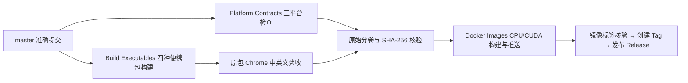

# 构建与发布指南

本文档说明 AI-RVC 便携可执行包、Docker 镜像及 GitHub Release 的标准构建、校验与发布流程。

## 发布前检查清单

1. **版本对齐**：确认 `VERSION`、`compose.yaml`、`compose.cpu.yaml`、`Dockerfile`、`docs/releases/v<版本>.md` 与 Git 标签指向同一版本号。
2. **多轨播放器构建**：在 `ui/multitrack` 执行 `npm ci --no-audit --no-fund && npm run build`，确保最新离线单文件 `ui/multitrack/dist/player.html` 已生成。
3. **依赖与源码校验**：
   - 执行 `python -m pip check` 确认无依赖冲突；
   - 执行 `python tools/package_runtime.py .` 校验全部 495 个固定官方 VC/UVR5 源码文件；
   - 执行 `python tools/audit_localization_terms.py` 确认控制台英文词典无漏译。
4. **完整回归与资产洁净**：
   - 执行 `python -m unittest discover -s tests` 全部通过；
   - 确认 `assets/weights/characters/_version_notes.json` 未被测试改写；
   - 确认便携包排除前端 `node_modules`、已移除模型权重及私有角色权重。

## 本地便携包构建流程

请先确保 `ffprobe` 可用（已加入 `PATH` 或放置于 `tools/ffmpeg/bin/`），在项目虚拟环境中依次执行：

```bash
# 1. 下载全部必需与默认分离模型
python tools/download_models.py --all

# 2. 校验固定官方源码
python tools/package_runtime.py .

# 3. 执行 PyInstaller 打包（自动收集 FFmpeg 并运行成品校验）
python -m PyInstaller AI-RVC.spec
```

打包完成后会自动执行 `tools/package_runtime.py dist/AI-RVC/_internal --packaged`（GPU 版附加 `--cuda 12.8` 验证 NVRTC 实际编译）以及 `tools/verify_packaged_runtime.py`：在源码树之外的独立中文目录与冷缓存中，实际执行 Float64/Float32 混响、librosa/resampy 重采样、DOUBLE WAV 混音、同曲分轨复用、中英文 HTTP 界面检查及第二进程缓存命中验证。

> **Numba 缓存说明**：`lib.mixer`、`librosa`、`resampy` 通过 `tools/pyinstaller_hooks/` 按真实包内源码收集，保证冻结程序在任意目录与中文路径下可正常定位源码并复用 Numba 磁盘缓存。

## GitHub Actions 发布工作流



- **`Release`（完整发布）**：从 `master` 触发，一次完成三平台合同测试、Windows/Linux CPU/GPU 四种便携包构建与冻结校验、分卷摘要核对、Docker CPU/CUDA 镜像检查与推送，最终使用 `docs/releases/v<版本>.md` 自动创建标签并公开发布。
- **`Build Executables`（构建审核）**：支持单独按平台（Windows/Linux）或变体（CPU/GPU）构建审核产物并生成 `PACKAGE-MANIFEST.json` 与 `SHA256SUMS`。
- **`Verify portable browser`（原包浏览器验收）**：下载已构建的原始 Windows CPU 分卷，校验分卷与完整清单后，在独立中文目录启动原样可执行程序，使用 Chrome 实测中英文切换、页面刷新恢复、动态表格与内嵌多轨播放器，并保存截图与日志。
- **`Replace existing portable packages`（同版本便携包更新）**：用于在不变更版本号的前提下，将通过全部核验的新四包产物原子替换到现有 Release（自动校验来源提交与每个分卷摘要，保留操作记录）。
